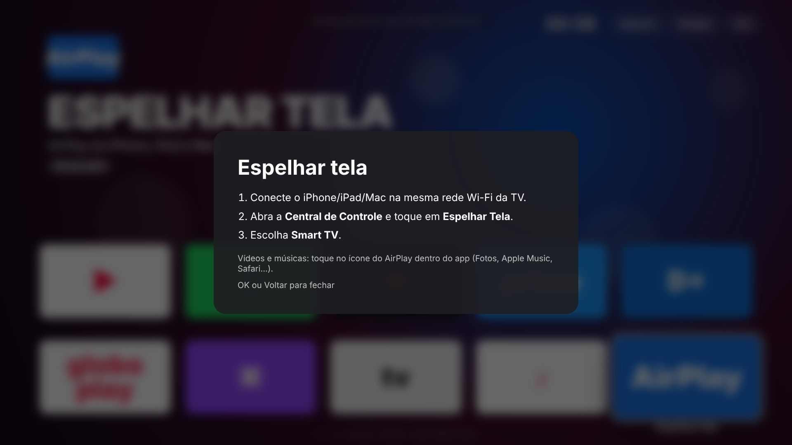

# Smart TV — launcher com apps nativos

Transforma o PC/monitor em uma Smart TV de verdade: liga direto no launcher, e cada app
(YouTube, Netflix, Spotify...) abre como **aplicativo próprio em tela cheia**, sem navegador,
sem aba, sem barra de endereço, controlado só pelo teclado ou controle remoto.


**Sistema recomendado:** Linux (Debian/Ubuntu) + este launcher em modo kiosk (`install-linux.sh --kiosk`).
O PC liga direto na TV, nunca mostra área de trabalho, e você controla tudo (visual, apps, teclas) pelo código.

## Integração com iPhone, iPad e Mac

| Recurso | Como usar |
|---|---|
| **AirPlay: espelhar tela** | Central de Controle → Espelhar Tela → **Smart TV** (ou o bloco "Espelhar tela" no launcher mostra o passo a passo) |
| **AirPlay: vídeos, fotos e músicas** | Ícone do AirPlay dentro do app (Fotos, Apple Music, Safari, YouTube...) |
| **iPhone como controle remoto** | Abra no Safari o endereço que aparece no topo da TV (ex.: `http://192.168.0.10:8765/4821`) → Compartilhar → **Adicionar à Tela de Início**. Vira um app com setas, OK, Voltar, Home, play/pause, volume, atalhos para os apps e **teclado do iPhone para digitar buscas e senhas** |
| **AirPods** | Pareie pelo Bluetooth do Linux (som da TV vai para os AirPods) |

O AirPlay usa o [UxPlay](https://github.com/FDH2/UxPlay) (receptor AirPlay de código aberto), instalado
pelo `install-linux.sh`. O nome que aparece no iPhone é o `settings.deviceName` do `apps.json`.
Conteúdo com DRM (Netflix, Apple TV+, Disney+) **não** pode ser enviado por AirPlay para receptores
que não são da Apple; para esses, use o app correspondente direto na TV.

O controle remoto só funciona na mesma rede Wi-Fi e exige o PIN que aparece na TV
(fica salvo, então o atalho na Tela de Início continua funcionando).

 

## O que muda em relação a abrir no navegador

| Antes (navegador) | Agora (app) |
|---|---|
| Abre `youtube.com` desktop numa aba do Chrome | Abre a **interface oficial de TV do YouTube** (`youtube.com/tv`), a mesma das Smart TVs Samsung/LG, feita para controle remoto |
| Barra de endereço, abas, menus | Janela própria em tela cheia, nada do navegador aparece |
| Mesmo login/cookies para tudo | **Login separado por app** (`persist:<id>`), fica salvo |
| Sites bloqueiam/limitam navegador "estranho" | User-agent de Chrome puro + **Widevine (DRM)** para Netflix, Prime, Disney+, Globoplay, Apple TV |
| Precisa de mouse | Setas + OK + Voltar + Home; navegação espacial nos sites que não são de TV |
| Fechar = fechar aba | **Home** volta ao início; Spotify/Apple Music continuam tocando em segundo plano (ponto verde no bloco) |

## Teclas (teclado ou controle remoto HDMI-CEC/air mouse)

| Tecla | Ação |
|---|---|
| ← ↑ → ↓ | Navegar |
| Enter / OK | Abrir |
| Esc / Voltar | Volta uma tela no app (no início do app, volta para a Home) |
| Home, tecla Windows ou Ctrl+H | Volta para o launcher |
| ↑ na primeira fileira | Menu Reiniciar / Desligar / Sair |

## Instalação

Requisitos: Node.js 20+.

```bash
cd smart-tv
npm install        # baixa o Electron da castLabs (Chromium + Widevine)
npm run dev        # testar em janela
npm start          # tela cheia (modo TV)
```

### Ligar direto na TV

**Linux**
```bash
./scripts/install-linux.sh           # abre sozinho ao entrar na sessão
./scripts/install-linux.sh --kiosk   # sem desktop: o PC liga direto na Smart TV (usa o compositor "cage")
```

**Windows**
```powershell
powershell -ExecutionPolicy Bypass -File scripts\install-windows.ps1          # inicia com o Windows
powershell -ExecutionPolicy Bypass -File scripts\install-windows.ps1 -Shell   # substitui o Explorer: só a TV
```

### Gerar instalador
```bash
npm run dist:linux   # AppImage + .deb
npm run dist:win     # instalador .exe
```

## Adicionar/editar apps

Edite `apps.json`. Para usar os logos reais, coloque um PNG em `icons/` (ex.: `icons/netflix.png`)
e adicione `"icon": "netflix.png"` ao app. Campos:

- `userAgent`: `"tv"` (pede a interface de TV), `"desktop"` ou uma string personalizada
- `tvUi: true`: o app já trata o botão Voltar sozinho (ex.: YouTube TV)
- `background: true`: continua tocando quando você volta para a Home

## Limitações

- **Netflix / Prime / Disney+** não têm versão "TV" pública para PC; eles abrem a versão web dentro
  da janela do app (sem navegador visível). Os apps de TV deles só rodam em aparelhos certificados.
- **DRM**: no Linux a Netflix limita a 720p (é assim também no Chrome). No Windows, para 1080p+
  é preciso assinar o app com o serviço gratuito EVS da castLabs
  (`pip install castlabs-evs && python -m castlabs_evs.vmp sign-pkg dist/win-unpacked`).
- O volume pelo controle do iPhone e o AirPlay funcionam no Linux; no Windows o launcher roda, mas
  sem essas duas funções.
- Se quiser **apps Android de verdade** (APKs da Play Store), a alternativa é instalar um sistema
  Android TV x86 (ex.: Bliss OS) no PC, em vez deste launcher.
