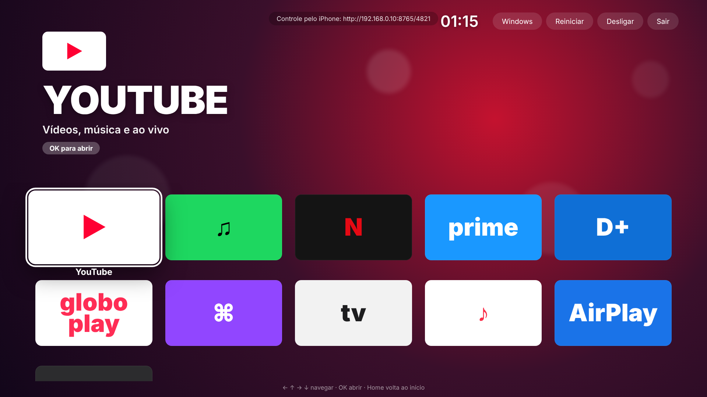
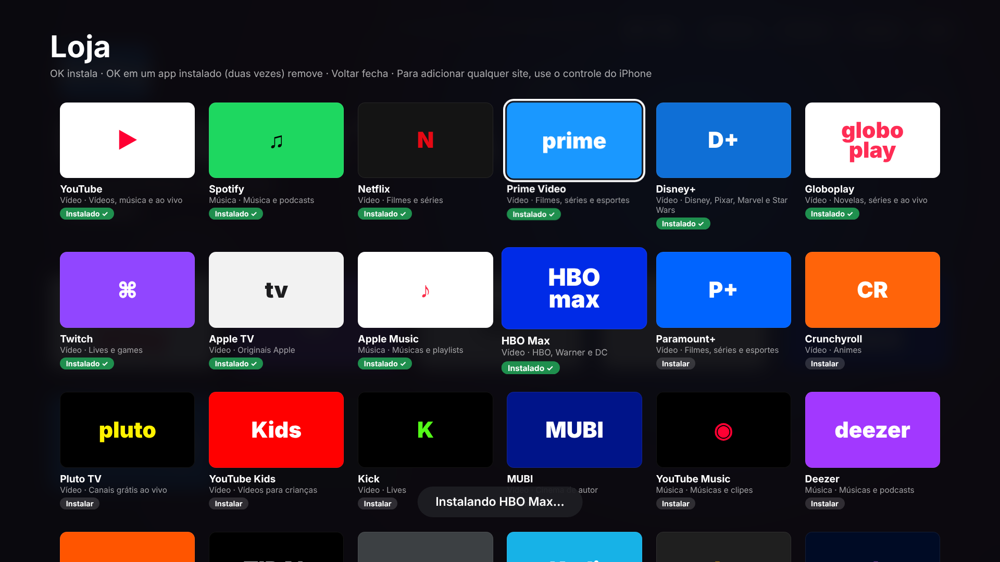
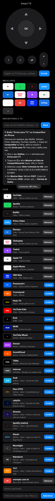

# Smart TV: sistema de TV para PC

Transforma o PC em uma Smart TV: liga direto no launcher, cada app abre como **aplicativo em
tela cheia** (sem navegador), tem **loja de aplicativos** (web e nativos), **AirPlay**,
**Spotify Connect**, **YouTube no botão de transmitir** e o **iPhone como controle remoto**.



**Base recomendada:** Ubuntu 24.04 + este launcher em modo kiosk. Guia completo, do pendrive de
teste ao dual boot com Windows: **[docs/INSTALACAO.md](docs/INSTALACAO.md)**.

```bash
git clone -b claude/smart-tv-native-app-d4pzo8 https://github.com/slipzin/finance-bot.git
cd finance-bot/smart-tv
./scripts/install-linux.sh           # teste (abre junto com a área de trabalho)
./scripts/install-linux.sh --kiosk   # modo TV (liga direto na TV)
```

## Loja de aplicativos

Último bloco da tela inicial (ou pela página do controle no iPhone).

| Tipo | Como funciona | Exemplos |
|---|---|---|
| **Apps web** | Janela de app própria, login salvo por app, DRM Widevine | Netflix, Prime Video, Disney+, Globoplay, HBO Max, Paramount+, Crunchyroll, Pluto TV, Deezer, YouTube Music, Tidal... |
| **Apps nativos** | Instalados de verdade pelo Flatpak (Flathub), sem senha | Kodi, Plex HTPC, Jellyfin, Stremio, Spotify oficial, Steam (Big Picture), Moonlight, RetroArch, VLC |
| **Qualquer site** | Pela página do controle no iPhone: nome + endereço | |

Para mudar o catálogo, edite `apps.json` (campos explicados no próprio arquivo). Logos reais:
coloque um PNG em `icons/` e adicione `"icon": "arquivo.png"` ao app.



## Transmitir do iPhone para a TV

| App no iPhone | Como enviar para a TV |
|---|---|
| **Qualquer app** (Netflix, Disney+, Prime, Globoplay, HBO Max, Apple TV...) | **Compartilhar → Enviar para TV**: a TV abre aquele filme/série/música no app certo (instala o app se precisar). Configuração única do atalho: veja a página do controle no iPhone. Também dá para colar o link na página do controle. |
| **YouTube** | Botão de transmitir → **Smart TV** (protocolo DIAL, como nas Smart TVs). Alternativa: na TV, YouTube → Configurações → *Vincular com código*. |
| **Spotify** | **Dispositivos disponíveis → Smart TV** (Spotify Connect, precisa de Premium). |
| **Apple Music, Fotos, Safari, vídeos** | Ícone do **AirPlay** → Smart TV. |
| **Tela inteira** | Central de Controle → **Espelhar Tela** → Smart TV. |

Por que a Netflix/Disney+/Prime/Globoplay não aparecem no botão de transmitir deles: esse botão
usa o Google Cast, que só funciona em aparelhos certificados pelo Google, e o AirPlay desses apps
usa o DRM da Apple. Por isso existe o **Enviar para TV**: o resultado é o mesmo (o conteúdo abre na TV)
e depois você controla pelo iPhone.

## iPhone como controle remoto

Abra no Safari o endereço que aparece no topo da TV (ex.: `http://192.168.0.10:8765/4821`) →
Compartilhar → **Adicionar à Tela de Início**. Vira um app com:

- setas, OK, Voltar, Home, play/pause e volume (segure a seta para repetir)
- **teclado do iPhone para digitar** buscas e senhas na TV
- atalhos dos apps, loja (instalar/remover) e "Enviar para a TV"
- funciona também dentro dos apps nativos (Kodi, Steam...)

Só funciona na mesma rede Wi-Fi e exige o PIN mostrado na TV (fica salvo).



## Teclas (teclado, controle HDMI-CEC ou air mouse)

| Tecla | Ação |
|---|---|
| ← ↑ → ↓ | Navegar |
| Enter / OK | Abrir |
| Esc / Voltar | Volta uma tela no app (no início do app, volta para a Home) |
| Home, tecla Windows ou Ctrl+H | Volta para o launcher (Home funciona também nos apps nativos) |
| ↑ na primeira fileira | Menu **Windows** (reinicia no Windows) / Reiniciar / Desligar / Sair |

Spotify, Apple Music, Deezer etc. continuam tocando ao voltar para a Home (ponto verde no bloco).

## Desenvolvimento

```bash
npm install
npm run dev      # em janela
npm start        # tela cheia
npm test         # testes (links, loja, DIAL, controle remoto)
```

Estrutura: `src/main.js` (janelas, apps, serviços), `src/store.js` (loja/Flatpak),
`src/links.js` (Enviar para TV), `src/dial.js` (YouTube DIAL), `src/remote-server.js` +
`src/remote/` (controle do iPhone), `src/services.js` (UxPlay/librespot), `src/launcher/` (interface).

## Limitações

- Apps web com DRM: Netflix limitada a 720p no Linux (como no Chrome).
- AirPlay de conteúdo protegido (Netflix, Disney+, Apple TV+) não funciona em receptores que não
  são da Apple: use o app na TV ou o "Enviar para TV".
- Windows: o launcher roda (`scripts/install-windows.ps1`), mas sem apps nativos, AirPlay,
  Spotify Connect e volume pelo iPhone. O sistema completo é o Linux.
